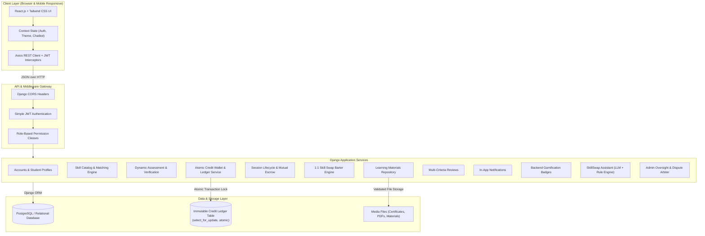
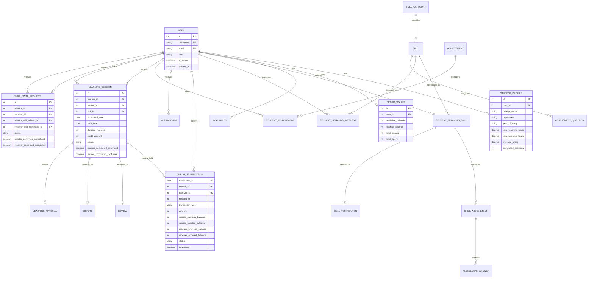
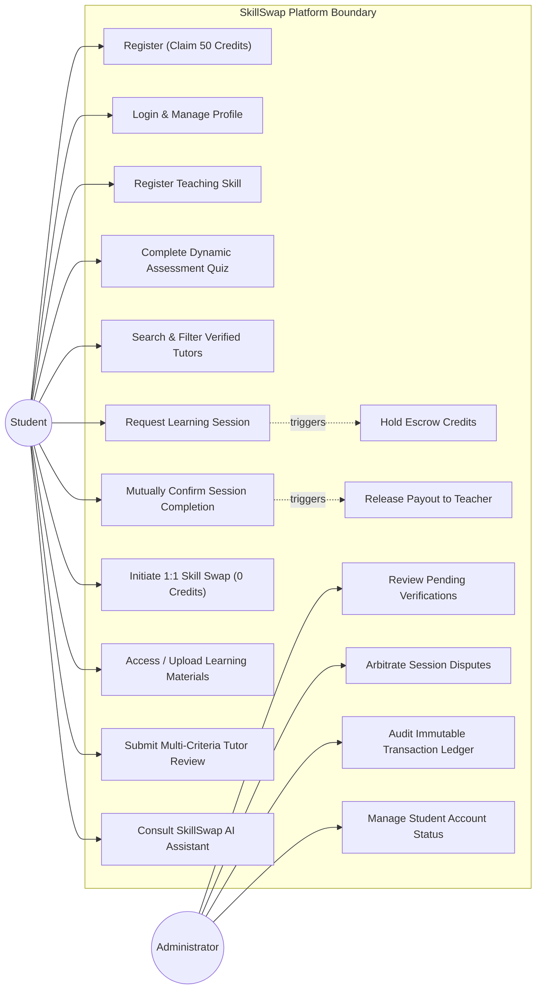
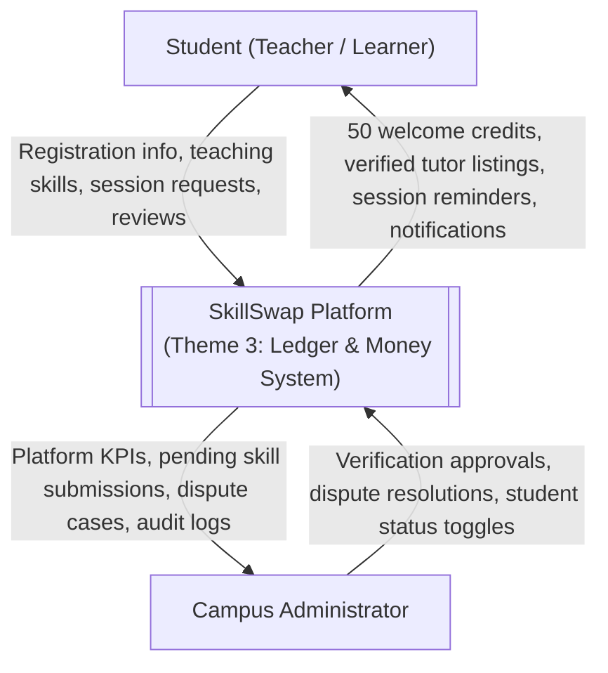
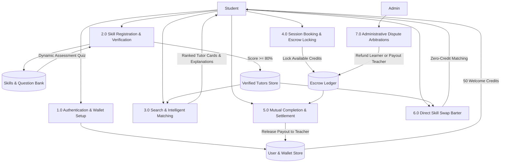
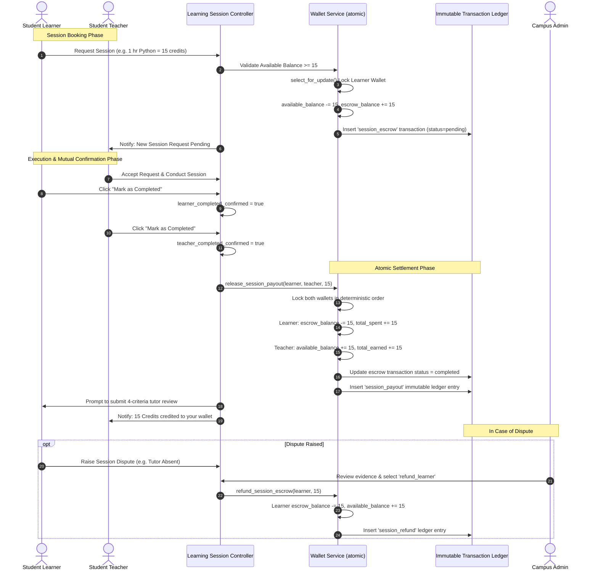

# SkillSwap System Diagrams & Visual Models
**Project Theme:** Theme 3 – Ledger and Money Systems  
**Project:** SkillSwap – Student Skill Exchange and Credit Ledger System

---

## 1. System Architecture Diagram

---

## 2. Entity-Relationship (ER) Diagram

---

## 3. Use Case Diagram

---

## 4. Data Flow Diagram (DFD) Level 0 – Context Diagram

---

## 5. Data Flow Diagram (DFD) Level 1 – Operational Processes

---

## 6. Data Flow Diagram (DFD) Level 2 – Credit Ledger & Escrow Settlement

